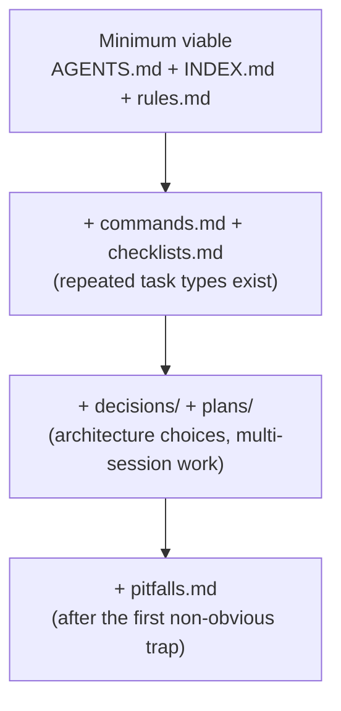

# Agent Harness

A reusable method for making any repository legible and safe for AI agents. The
output is a small set of plain-markdown docs — no framework, no runtime, no
IDE dependency. It works with any agent that can read files (Cursor, Claude,
Codex, Factory, or a plain LLM given the repo).

The anchor is `AGENTS.md` at the repo root — the cross-agent de-facto standard
entry point. Everything else hangs off it.

## When to use

- Bootstrapping a repo so agents stop guessing where things are or what the rules are.
- Onboarding an agent to an existing project (condense tribal knowledge into docs).
- Standardizing engineering constraints a team keeps repeating in review.
- Auditing and fixing **doc-code drift** (docs describing things the code no longer does).

## The 8 building blocks

Each block is one file (or one folder). Adopt only what the project needs — see
the Adoption Ladder. Copy starters from [templates/](templates/).

| # | Block | File | Answers | Template |
|---|---|---|---|---|
| 1 | Entry point | `AGENTS.md` | "Where do I start? What's the one-paragraph shape of this repo?" | [templates/AGENTS.md](templates/AGENTS.md) |
| 2 | Knowledge index | `docs/INDEX.md` | "Where do I find X?" (navigation by task) | [templates/INDEX.md](templates/INDEX.md) |
| 3 | Hard rules | `docs/rules.md` | "What must I always / never / ask-first do?" + Doc Sync Matrix | [templates/rules.md](templates/rules.md) |
| 4 | Decisions | `docs/decisions/` | "Why is it built this way?" (append-only ADRs) | [templates/ADR-TEMPLATE.md](templates/ADR-TEMPLATE.md) |
| 5 | Execution plans | `docs/plans/` | "What is the state of this multi-session task?" | [templates/PLAN-TEMPLATE.md](templates/PLAN-TEMPLATE.md) |
| 6 | Checklists | `docs/checklists.md` | "What are the ordered steps for task type T?" | [templates/checklists.md](templates/checklists.md) |
| 7 | Pitfalls | `docs/pitfalls.md` | "What trap has already been solved?" (symptom → cause → fix) | [templates/pitfalls.md](templates/pitfalls.md) |
| 8 | Command contracts | `docs/commands.md` | "What is the smallest command that proves my change?" | [templates/commands.md](templates/commands.md) |

Directory layout is a convention, not a requirement. Many teams put 3, 6, 7, 8
under a `harness/` folder. Keep whatever the project already uses; do not
reorganize an existing repo just to match this.

## Two cross-cutting conventions

These make the difference between docs an agent trusts and docs it ignores.

### Fact Priority

State an explicit conflict-resolution order at the top of `AGENTS.md`, so an
agent knows what to believe when two sources disagree. Generic default:

```text
Code + dependency manifests   (the running truth)
  > stable/adopted specs/contracts
  > active architecture docs and accepted decisions
  > drafts / planning notes / examples
```

Without this, agents treat a stale doc as gospel and "fix" working code.

### status + kind frontmatter

Tag every harness doc so its lifecycle is legible at a glance:

```yaml
---
status: draft | active | stable | accepted | deprecated
kind: index | rules | decision | plan | checklist | pitfalls | commands
---
```

`draft` = must not be treated as implemented. `accepted` (ADRs) = never edited
in place; supersede with a new record instead.

## Doc Sync Matrix — the keystone

The single highest-value, most-often-neglected block. It turns "remember to
update the docs" into a mechanical lookup. In `rules.md`, map each **kind of
code change** to the **docs that must change with it**:

| Change type | Docs to update |
|---|---|
| New public module / package / service | index of modules; dependency manifest; status/inventory doc |
| New public API / interface | API reference or quick-reference table |
| Contract/spec status change (draft→active→stable) | spec index; status doc |
| Architecture decision (layering, error model, deps) | new ADR in `decisions/` |
| Multi-session task progressed | the plan file's Progress + Verification |
| Module renamed or deleted | every doc above that referenced it |

Fill the left column with the change types that actually recur in the target
project. This is the part to invest in — most drift happens because this matrix
does not exist or is not consulted.

## Bootstrap workflow

Introduce the harness proportionally — do not dump all 8 blocks on a small repo.

### Adoption Ladder



Steps:

1. Read the repo first. Identify: primary language(s)/build tool, top-level
   layout, the real fact source (code + manifest), and the 3–5 rules the team
   repeats. Do not invent rules the codebase does not follow.
2. Start at L1. Copy [templates/AGENTS.md](templates/AGENTS.md) and
   [templates/INDEX.md](templates/INDEX.md), fill placeholders with the repo's
   actual layout and fact priority. Keep `AGENTS.md` short — it is a router, not
   a manual.
3. Write `rules.md` from observed constraints. Draft the Doc Sync Matrix from
   the change types this repo actually sees.
4. Climb the ladder only when a real need appears (a recurring task → add a
   checklist; an architecture choice → add an ADR; a multi-session task → add a
   plan; a nasty bug → add a pitfall).

Principle: one authoritative location per rule; everything else links to it. Do
not duplicate a rule into three files — link. Deeper rationale and anti-patterns:
[principles.md](principles.md).

## Maintenance workflow — auditing drift

Run this when asked to "check the docs" or after a batch of code changes. It is
language- and framework-agnostic; no script required (teams may script it later
in their own stack).

Portable Doc-Sync audit — for each recently changed area:

1. **Fact source vs index.** List real modules/packages from the code +
   manifest. Confirm each appears in the knowledge index and its layer index.
   Flag any present in code but missing from docs (and vice versa).
2. **Fact source vs status doc.** Confirm each shipped capability is in the
   status/inventory doc; confirm nothing marked "done" is actually absent.
3. **Spec/contract status.** Confirm `status:` frontmatter matches reality (no
   `draft` for something already in use; no `stable` for something unused).
4. **Placeholders.** Grep for estimate markers (`~`, `TBD`, `—`, `???`) in
   fields that should be facts; replace with real values or mark unknown.
5. **Dangling references.** Confirm docs do not reference deleted files,
   renamed modules, or "planned" tools as if they exist.

Report findings as: fact source → which doc is out of sync → the corrected line.
Fix in the doc that is the single authoritative location.

## Cross-agent install

The harness content (blocks 1–8) is plain markdown any agent reads directly via
`AGENTS.md`. This skill wrapper (`SKILL.md` + templates) uses the shared Skills
format, so the same directory works across agents that support skills:

```bash
# One canonical copy, symlinked into each agent's personal skills dir:
ln -s ~/.cursor/skills/agent-harness ~/.claude/skills/agent-harness
ln -s ~/.cursor/skills/agent-harness ~/.codex/skills/agent-harness
```

Agents without a skills mechanism still benefit: point them at the target repo's
`AGENTS.md`, which is the universal entry point this skill produces.

## Anti-patterns

- Copying another project's *content* (its specific layers, rules, stack) instead of its *structure*. Fill templates from the target repo's reality.
- A long `AGENTS.md`. It routes; detail lives behind links (progressive disclosure).
- Rules the code does not actually follow — aspirational docs erode trust fast.
- Building all 8 blocks for a 3-file project. Climb the ladder.
- Duplicating a rule across files instead of linking to one authoritative copy.

See [principles.md](principles.md) for the reasoning behind each convention.
