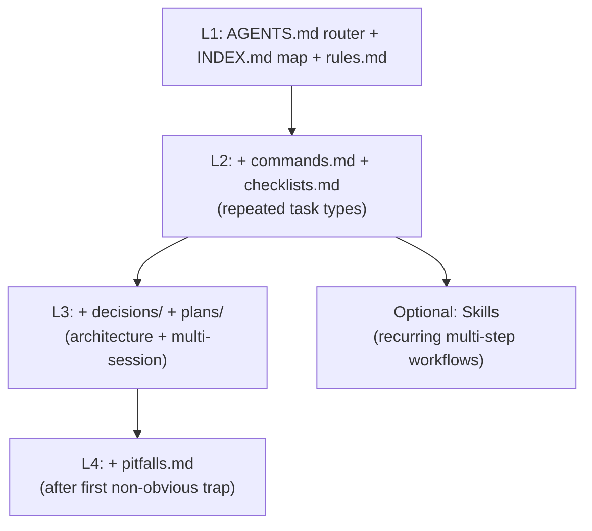

# Agent Harness

Create a small, plain-Markdown operating manual that lets any coding agent work
in a repository without guessing. It is framework- and vendor-neutral: the
target repository supplies its real structure, tooling, and constraints.

Use `AGENTS.md` as the cross-agent entry point ([agents.md](https://agents.md/)).
Keep it a short router (about 100 lines), with detail linked on demand from
`docs/` and, when useful, `harness/`. Do not turn it into an encyclopedia.

## Operating Modes

Choose one mode before writing:

| Mode | Goal | Output |
|---|---|---|
| Bootstrap | Establish the smallest useful harness | Adoption Ladder level justified by repository evidence |
| Adapt | Improve an existing harness | Targeted edits that preserve authoritative locations |
| Drift audit | Reconcile docs and implementation | Findings and corrections in the owning documents |

In all modes, inspect the repository before making claims. Derive facts from
implementation, manifests, existing commands, CI, and established conventions.
Do not copy a source project's stack, commands, layers, or rules into the
target repository.

## Building Blocks

Each block is one file (or one folder). Adopt only what the project needs — see
the Adoption Ladder. Copy starters from [templates/](templates/).

| # | Block | File | Answers | Template |
|---|---|---|---|---|
| 1 | Entry point | `AGENTS.md` | "Where do I start? What's the one-paragraph shape of this repo?" | [templates/AGENTS.md](templates/AGENTS.md) |
| 2 | Knowledge index | `docs/INDEX.md` | "Where do I find X?" (navigation by task) | [templates/INDEX.md](templates/INDEX.md) |
| 3 | Hard rules | `<HARNESS_DIR>/rules.md` | Always / Ask First / Never + Doc Sync Matrix | [templates/rules.md](templates/rules.md) |
| 4 | Decisions | `docs/decisions/` | "Why is it built this way?" (append-only ADRs) | [ADR-TEMPLATE](templates/ADR-TEMPLATE.md) · [index](templates/decisions/README.md) |
| 5 | Execution plans | `docs/plans/` | "What is the state of this multi-session task?" | [PLAN-TEMPLATE](templates/PLAN-TEMPLATE.md) · [index](templates/plans/README.md) |
| 6 | Checklists | `<HARNESS_DIR>/checklists.md` | "What are the ordered steps for task type T?" | [templates/checklists.md](templates/checklists.md) |
| 7 | Pitfalls | `<HARNESS_DIR>/pitfalls.md` | "What trap has already been solved?" | [templates/pitfalls.md](templates/pitfalls.md) |
| 8 | Command contracts | `<HARNESS_DIR>/commands.md` | "What is the smallest command that proves my change?" | [templates/commands.md](templates/commands.md) |

`<HARNESS_DIR>` is usually `harness/` or `docs/`. Optional folder index:
[templates/harness-INDEX.md](templates/harness-INDEX.md). Keep whatever the
project already uses; do not reorganize an existing repo just to match this.

Optional (not a 9th block): project **Skills** for multi-step workflows that
recur — link them from `AGENTS.md` / `docs/INDEX.md`; durable rules stay in
blocks 3–8.

## Core Conventions

These make the difference between docs an agent trusts and docs it ignores.

### Fact Priority

State an explicit conflict-resolution order. Put the **full table once** in
`docs/INDEX.md`; `AGENTS.md` links to it. Generic default:

```text
Code + dependency manifests   (the running truth)
  > stable/adopted specs/contracts
  > active architecture docs and accepted decisions
  > drafts / planning notes / examples
```

Without this, agents treat a stale doc as gospel and "fix" working code.

### Git-Safe Change Workflow

For repositories using Git, make the expected change discipline explicit in
`rules.md` and reinforce it in checklists:

1. Inspect `git status --short` and the relevant diff before editing.
2. Treat pre-existing changes as another owner's work unless their ownership is
   clear; preserve them and keep the current change scoped.
3. Review the final diff for unrelated edits, generated artifacts, secrets, and
   accidental formatting churn.
4. Ask before history-rewriting, destructive cleanup, force-pushing, publishing,
   or committing when the repository's policy requires explicit approval.

Never make Git commands an invented project gate. Put exact repository-specific
commands in `commands.md`; keep this section as the portable behavioral
baseline. For repositories without Git, use the equivalent status and diff
mechanism, or omit the Git-specific wording.

### status + kind frontmatter

Tag every harness doc so its lifecycle is legible at a glance:

```yaml
---
status: draft | active | stable | accepted | paused | completed | deprecated | reference
kind: index | rules | decision | plan | checklist | pitfalls | commands
---
```

`draft` = must not be treated as implemented. `accepted` (ADRs) = never edited
in place; supersede with a new record instead. Plan statuses:
`draft | active | paused | completed`.

## Doc Sync Matrix — the keystone

The single highest-value, most-often-neglected block. It turns "remember to
update the docs" into a mechanical lookup. In `rules.md`, map each **kind of
code change** to the **docs that must change with it**.

**Trigger when** public capabilities, inventory, adopted contracts, architecture
decisions, or migration status change. **Do not trigger** for internal
refactors, private implementation, tests, formatting, or behavior-preserving
bug fixes.

| Change type | Docs to update |
|---|---|
| New public module / package / service | module index; status/inventory doc |
| New public API / interface | API reference or quick-reference table |
| Contract/spec status change (draft→active→stable) | spec index; status doc |
| Architecture decision (layering, error model, deps) | new ADR in `decisions/` |
| Multi-session task progressed | the **active** plan's Progress + Verification |
| Module renamed or deleted | every doc above that referenced it |

Fill the left column with the change types that actually recur in the target
project. Prefer mechanical checks (inventory vs code, dangling links, optional
CI/doc-gardening) over aspirational reminders.

## Bootstrap and Adapt Workflow

Introduce the harness proportionally; do not dump all eight blocks on a small
repository.

### Adoption Ladder



Steps:

1. Inventory the repository. Read root and nested agent instructions, manifests,
   root layout, existing docs, automation/CI, and Git state when present.
   Identify the fact source, real verification commands, public surface, and
   repeatedly enforced constraints. Do not invent rules the codebase does not
   follow.
2. Decide the adoption level. Start at L1 for a new repository; add a block
   only for a demonstrated need. Preserve the existing placement of docs unless
   a move itself solves a real ownership problem.
3. Start at L1. Copy [templates/AGENTS.md](templates/AGENTS.md) and
   [templates/INDEX.md](templates/INDEX.md). Fill from the repo's reality.
   `AGENTS.md` = short router (by-intent table + common routes);
   `INDEX.md` = full Fact Priority table + Path Map + task navigation.
4. Write `rules.md` from observed constraints (Always / Ask First / Never),
   including the Git-safe baseline when applicable.
   Draft the Doc Sync Matrix from change types this repo actually sees —
   including when **not** to sync.
5. Record only actual commands in `commands.md`; select the smallest proving
   command per change type. Add a generic scoped-change checklist before
   specialized recurring checklists.
6. Climb the ladder only when a real need appears (recurring task → checklist;
   architecture choice → ADR; multi-session work → plan; nasty bug → pitfall;
   recurring multi-step workflow → optional Skill).

Before close-out, remove unfilled template markers, verify links and relative
paths, confirm every rule has one authoritative location, and run the smallest
relevant validation available. Report what was not run.

Principle: one authoritative location per rule; everything else links to it. Do
not duplicate a rule into three files — link. Deeper rationale and anti-patterns:
[principles.md](principles.md).

## Drift Audit

Run this when asked to check documentation or after a batch of code changes.
It is language- and framework-agnostic; projects can automate it later.

Portable Doc-Sync audit — for each recently changed area:

1. **Fact source vs index.** List real modules/packages from the code +
   manifest. Confirm each appears in the knowledge index and its layer index.
   Flag any present in code but missing from docs (and vice versa).
2. **Fact source vs status doc.** Confirm each shipped capability is in the
   status/inventory doc; confirm nothing marked "done" is actually absent.
3. **Spec/contract status.** Confirm `status:` frontmatter matches reality (no
   `draft` for something already in use; no `stable` for something unused).
4. **Placeholders.** Grep for estimate markers (`~`, `TBD`, `—`, `???`) in
   fields that should be facts; replace with real values or mark unknown.
5. **Commands and workflow claims.** Confirm every listed command, generator,
   build target, and Git workflow is real and has the stated scope.
6. **Dangling references.** Confirm docs do not reference deleted files,
   renamed modules, or "planned" tools as if they exist.

Report findings as: fact source → which doc is out of sync → the corrected line.
Fix in the doc that is the single authoritative location.

## Cross-Agent Use

The harness content (blocks 1–8) is plain markdown any agent reads directly via
`AGENTS.md`. This skill wrapper (`SKILL.md` + templates) uses the shared Skills
format, so the same directory works across agents that support skills:

```bash
# One canonical copy, symlinked into each agent's personal skills dir:
ln -s ~/.cursor/skills/agent-harness ~/.claude/skills/agent-harness
ln -s ~/.cursor/skills/agent-harness ~/.codex/skills/agent-harness
```

Agents without a skills mechanism still benefit: point them at the target repo's
`AGENTS.md`, which is the universal entry point this skill produces.

IDE overlays (for example, Cursor `.cursor/rules/`) may add activation-scoped
hints; durable cross-agent facts stay in the harness. Do not fork two sources
of truth.

## Anti-patterns

- Copying another project's content (its specific layers, rules, stack) instead of its structure. Fill templates from the target repo's reality.
- A long `AGENTS.md`. It routes; detail lives behind links (progressive disclosure).
- Rules the code does not actually follow — aspirational docs erode trust fast.
- Building all 8 blocks for a 3-file project. Climb the ladder.
- Duplicating a rule across files instead of linking to one authoritative copy.
- Treating every code change as a Doc Sync event (over-sync creates noise and rot).
- Treating a clean working tree as an assumption, or using destructive Git
  commands to make it clean. Preserve unrelated work and ask before risky
  history or remote operations.

See [principles.md](principles.md) for the reasoning behind each convention.
